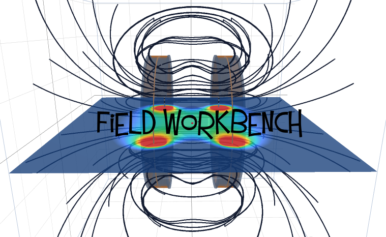

# Field Workbench

### A project-oriented workspace for biological magnetic-field design and analysis



## Table of Contents

1. [Introduction](#1-introduction)
2. [Suite applications](#2-suite-applications)
3. [Contribute and Collaborate](#3-contribute-and-collaborate)
4. [Getting Started](#4-getting-started)
5. [Tutorials and Demonstrations](#5-tutorials-and-demonstrations)

See [CHANGES.md](CHANGES.md) for release history and recent changes.

## 1. Introduction

Field Workbench (FWB) is an open magnetic-field design and analysis suite for building, visualizing, documenting, sharing, and comparing ELF biological exposure systems. Projects are managed from a central Project Manager and can contain electromagnetic models, rendered maps, reusable waveforms, time-varying exposure protocols, measurement datasets, and persistent calculated results.

The modeling layer is built around Magpylib / Magpylib Studio and includes tools specific to biological research, including specimen trays, a generic bust, an SRI24-derived brain with LPBA40 regional analysis, and UPENN-GBM tumour models. Waveforms and exposure protocols can be stored with a project and analysed independently of visualization playback. Model export provides paths to FEMM, Gmsh/GetDP, and COMSOL (COMSOL export remains untested).

## 2. Suite applications

Each open project has one shared project context. The Project Manager owns project lifetime and save state; the suite applications can be opened and used independently for that project:

- **Model Editor** — build and inspect field sources, sensors, geometry, measurement volumes, coil construction, design-rule checks, and optimization.
- **Map Creator** — create Static or Scripted 2D, 3D, and Brain visualizations, including saved-exposure playback.
- **Saved Results** — reopen and manage cached Static/Scripted maps, Exposure Analysis resources, and quantitative Measurement-volume snapshots.
- **Exposure Editor** — author physical-duration source/routing protocols and launch full-exposure analysis.
- **Waveform Editor** — create, import, edit, and export reusable Current/Voltage waveforms and encoded waveform formats.
- **Dataset Manager** — manage measured datasets, calibration/composite fits, and coil-correction links.

Built-in **Help Topics** documents the current workflows, analysis definitions, limitations, and research/reference basis.

## 3. Contribute and Collaborate

Field Workbench is under active development. Participation is welcome, including workflow testing, model validation, technical review, documentation, and feature or object requests. Start a discussion with what you would like to test, improve, or add.

## 4. Getting Started

### Windows

1. Download the current Windows release ZIP from the repository's **Releases** page.
2. Extract the complete `FieldWorkbench` folder; keep its `_internal` directory and bundled resources together.
3. Run the Field Workbench executable.
4. Windows may show a security prompt for an unsigned build; review the publisher/file source before choosing to run it.

### Linux

The development environment is primarily tested on Debian-family x86-64 systems. Install the source release into a virtual environment:

```bash
unzip FieldWorkbench_x.x.x.x_Source.zip
cd field_workbench
python3 -m venv .venv
source .venv/bin/activate
python -m pip install --upgrade pip
python -m pip install -r requirements.txt
```

Launch from the project directory:

```bash
source .venv/bin/activate
python app.py
```

For Windows packaging, release validation, optional developer dependencies, and external solver acceptance, see [BUILDING_WINDOWS.md](BUILDING_WINDOWS.md) and [TESTING.md](TESTING.md).

## 5. Tutorials and Demonstrations

Feature highlights: https://youtu.be/Dzqq4sYlIf8

Maxwell Coil demo: https://youtu.be/poaRiSmKelA

These videos may predate the current Project Manager / suite layout; use the built-in Help Topics for the current interface and workflows.

---

Field Workbench is licensed under the [GPL](PROJECT_NOTICE.txt). Some components are separately licensed by their respective authors; see [THIRD_PARTY_NOTICES.txt](THIRD_PARTY_NOTICES.txt).
